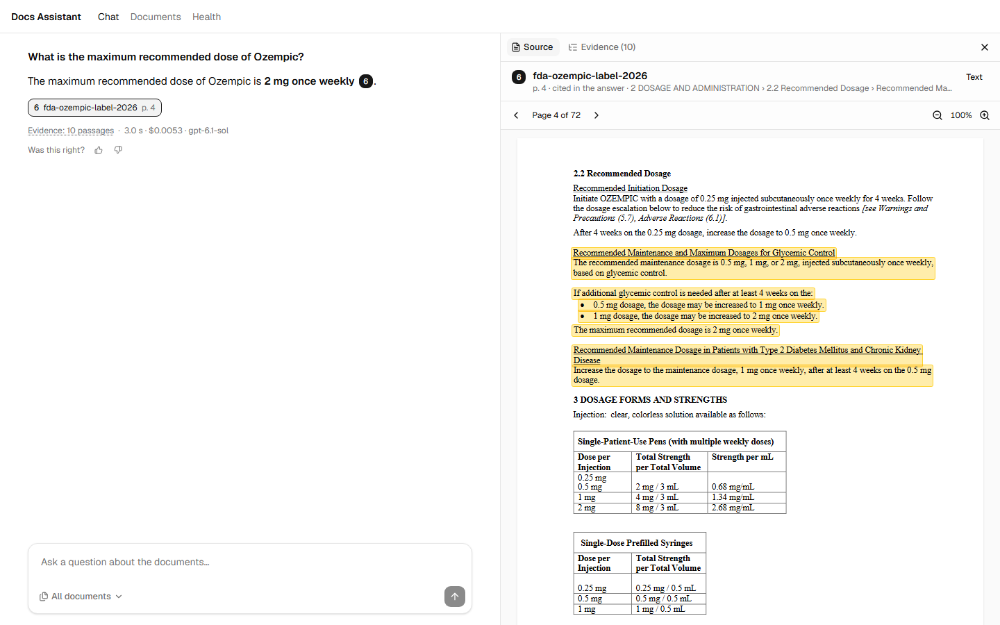
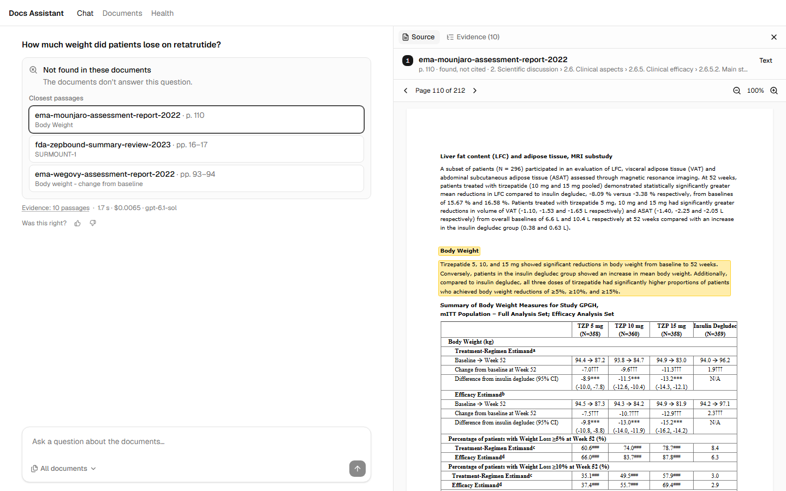
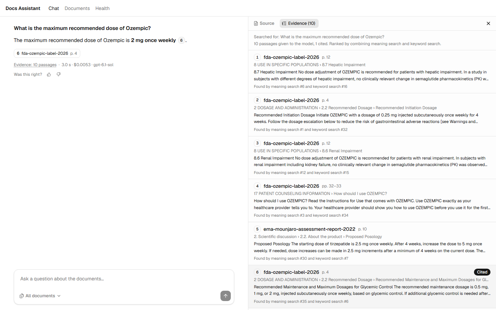
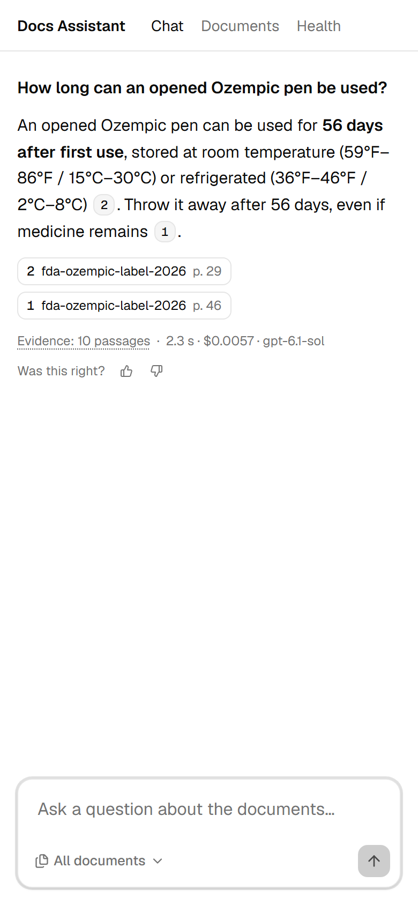
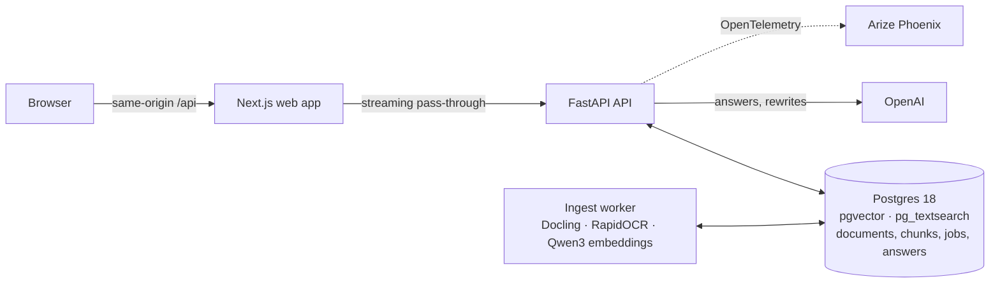

# GLP-1 Docs Assistant

Ask questions across a collection of PDFs and get answers where **every claim links to the exact
passage it came from, highlighted on the page**. When the documents don't contain the answer, it
says so plainly and shows the closest passages instead of guessing.

The demo collection is 18 public FDA and EMA documents on the GLP-1 drug family (Byetta, Victoza,
Trulicity, Ozempic, Wegovy, Mounjaro, Zepbound), 2005 to today: labels, approval letters, review
memos, EMA assessment reports, and two fully scanned older reviews. The engine itself is generic:
nothing in the code assumes this collection.



## What it does

- **Grounded answers, streamed.** Each claim cites passages by number; a click opens the PDF at
  that page with the passage highlighted, on text pages and on OCR'd scans alike.
- **Honest refusals.** "Not found in these documents" (or "outside what these documents can
  answer" for personal medical advice), with the three closest passages to check yourself. An
  answer that cites nothing is never shown as an answer.
- **Evidence you can inspect.** For every answer, all ten passages the model was given, which
  ones it cited, and which search found each one.
- **Follow-up questions.** "And for Mounjaro?" is rewritten into a full question before searching.
- **Your own documents.** Upload PDFs and watch them being read, page by page; ask about one
  document or all of them.
- **Feedback** on every answer, and **one trace per question** (retrieval, model calls, tokens,
  cost, latency) in Arize Phoenix.

| Refusal with the closest passages | Evidence behind an answer | On a phone |
|---|---|---|
|  |  |  |

## Results

Measured on a hand-checked gold set of 36 questions (`evals/gold.jsonl`: facts, tables, scanned
pages, comparisons, follow-ups, questions the documents can't answer, and prompt-injection
attempts), on a laptop CPU with OpenAI's API:

| | |
|---|---|
| Gold questions handled correctly (answered citing the right passage, or refused when unanswerable) | **78%** (28 of 36) |
| Answerable questions answered with the right citation | 77%, every miss a retrieval miss: once the model had the passage, it never failed |
| Answers judged correct by an LLM judge (all 36 questions; refusals scored right only when the documents can't answer) | **81%** (29 of 36) |
| Claims backed by the passage they cite | 99% (87 of 88); citation marks that back their claim: 84% |
| Retrieval: right passage in the top 10 (hybrid search) | 79% (vector alone 66%, keyword alone 68%) |
| Click on a citation → passage highlighted on the page | **533 ms** median (PDF download included) |
| Question → first words of the answer | 1.9 s median |
| Cost per question | $0.006 |

The judge (gpt-6-astra) splits each answer into claims, checks each one against the passages
it cites, and grades the answer against the gold reference. It was checked against 41 answers
labelled by Claude, including 12 deliberately broken copies (a changed number, a swapped
citation, a dropped sentence, an invented claim). Its first prompt, written before any label,
agreed on 85% of answers for correctness (kappa 0.67) and 98% for citation support, every
disagreement the judge being stricter; it caught every broken copy the labels reject and
rejected none they accept. One prompt change then reached full agreement, but it was written
by the same model that wrote the labels, so that figure is not an independent test. Judged
twice, it gave the same verdicts on all 57 saved answers.

Details: [`evals/results/`](evals/results), and the reasoning behind each number in
[`docs/decisions.md`](docs/decisions.md).

## Try it

You need Docker. The containers run with a fake model by default, so no API key is needed to see
the app work (answers will be refused, since the fake model cites nothing).

```bash
uv run scripts/fetch_corpus.py   # downloads the 18 demo PDFs (66 MB) into corpus/
docker compose up --build        # Postgres, API, ingest worker, web app, Phoenix
```

Then open <http://localhost:3000>, go to **Documents** and upload PDFs from `corpus/` (or run
`uv run python scripts/ingest_corpus.py --workers 2` to ingest them all). Reading the whole
collection takes roughly 45 minutes of worker time on a laptop CPU, mostly OCR and embeddings.

For real answers, copy `.env.example` to `.env`, set `LLM_PROVIDER=openai` and
`OPENAI_API_KEY`, and run `docker compose up --build` again. Traces are at
<http://localhost:6006>.

Native development (API, worker and web app outside Docker) is described in
[`CLAUDE.md`](CLAUDE.md#commands).

## How it works



**Ingestion keeps provenance.** Docling parses each PDF into blocks; pages without a text layer go
through OCR. A section-aware chunker cuts passages (median ~100 tokens, never over 450) that never cross a section,
splits tables by rows with their header repeated, and keeps, for every character, the page and
box it came from. Chunks are embedded locally (Qwen3-Embedding-0.6B) and indexed for keyword
search (BM25). The queue is a Postgres table; workers claim jobs with `FOR UPDATE SKIP LOCKED`.

**Retrieval is hybrid.** Vector search finds paraphrases, BM25 finds exact names and doses and
the OCR'd pages; reciprocal rank fusion merges the two rankings. A follow-up is first rewritten
into a standalone question by a small, fast model.

**Answers are checked, not trusted.** The ten best passages go to the model as quoted, numbered
blocks, never as instructions; text that tries to close a block or fake one is defused. The model
cites `[n]`; the API maps each number back to its chunk and boxes, drops numbers that name no
passage, and turns a reply that cites nothing, or a "not found", into a refusal with the closest
passages. Answers stream to the browser as server-sent events and are saved with their tokens,
cost, timings and trace id.

**The viewer draws highlights from stored boxes.** react-pdf renders the page; each passage's
boxes (normalised to the page) are overlaid by percentage, so highlights stay aligned at any zoom,
on scans, and on rotated pages.

| | Choice |
|---|---|
| Web | Next.js 16 (App Router), TypeScript strict, Tailwind, shadcn/ui, react-pdf; API types generated from OpenAPI |
| API and worker | Python 3.12, FastAPI, Pydantic v2, SQLAlchemy 2 + Alembic, uv |
| Parsing | Docling with RapidOCR (OCR only where a page has no text layer) |
| Storage and search | Postgres 18 with pgvector (HNSW) and pg_textsearch (BM25); nothing else stores data |
| Models | OpenAI gpt-6.1-sol for answers, gpt-6-luna for rewriting, behind one `LLMProvider` interface; local Qwen3-Embedding-0.6B |
| Observability | OpenTelemetry → Arize Phoenix, structlog |
| Tests | pytest with a real Postgres (testcontainers), Vitest, Playwright end to end; CI runs everything with a fake model |

No GPL or AGPL code or model weights. The documented exceptions: OpenCV's wheels (pulled in by
the OCR engine) bundle an unused LGPL FFmpeg, and two dev-only tools are MPL-2.0. Each
non-obvious choice, with the options rejected and the numbers behind it, is in
[`docs/decisions.md`](docs/decisions.md).

## Taking it to production

What would change to run this on AWS, GCP or Azure:

- **Files** move from Postgres to object storage (S3, GCS, Blob), served through a CDN with range
  requests so large PDFs show their first page before downloading.
- **Database:** managed Postgres services don't offer pg_textsearch, so either run Postgres
  yourself (VM or Kubernetes) or move BM25 to a managed search service; pgvector is available
  everywhere.
- **Ingest** scales by adding workers, autoscaled on queue depth; embeddings and OCR move to a GPU
  or an ONNX build, which removes most of the 45-minute first ingest.
- **API and web** run as containers (ECS/Fargate, Cloud Run, Container Apps) behind a load
  balancer; the API key moves to a secret manager.
- **Missing for real users:** authentication and per-tenant document collections, rate limits and
  cost caps per user, and keeping prompts and document text out of traces sent to a shared
  observability backend.

## Known limitations

- About a fifth of answerable questions fail at retrieval: wording mismatches ("dose" against the
  label's "dosage") and long scanned passages. Three off-the-shelf cross-encoder rerankers made it
  worse (recall@5 0.645 without, 0.60 at best with) and slower on CPU
  ([`reranker-trial.md`](evals/results/reranker-trial.md)); query expansion or a reranker tuned on
  regulatory text is what's left to try.
- The judge's calibration labels were written by Claude, a second model, not by a domain expert,
  and Claude also wrote the prompt change that followed, so the held-out half was not held out
  from it. Two models can share a blind spot; a regulatory reviewer labelling a fresh set is the
  real test of the judge.
- Conversations live in the browser tab (each answer is saved, the conversation isn't); the
  viewer shows one page at a time; English only.

## Project docs

- [`docs/decisions.md`](docs/decisions.md): every non-obvious technical choice, the options
  rejected, and the measurements behind it.
- [`docs/ai-usage.md`](docs/ai-usage.md): the AI-assisted development log.
- [`CLAUDE.md`](CLAUDE.md): project rules, stack, commands and build phases.
- [`evals/`](evals): the gold set, the eval harnesses and their results.

## Sources and licence

The demo documents are downloaded, not committed. FDA documents (Drugs@FDA) are US government
works in the public domain. EMA documents are reproduced with the source acknowledged:
**Source: European Medicines Agency** (ema.europa.eu). Nothing here is medical advice.

Code: [MIT](LICENSE).
